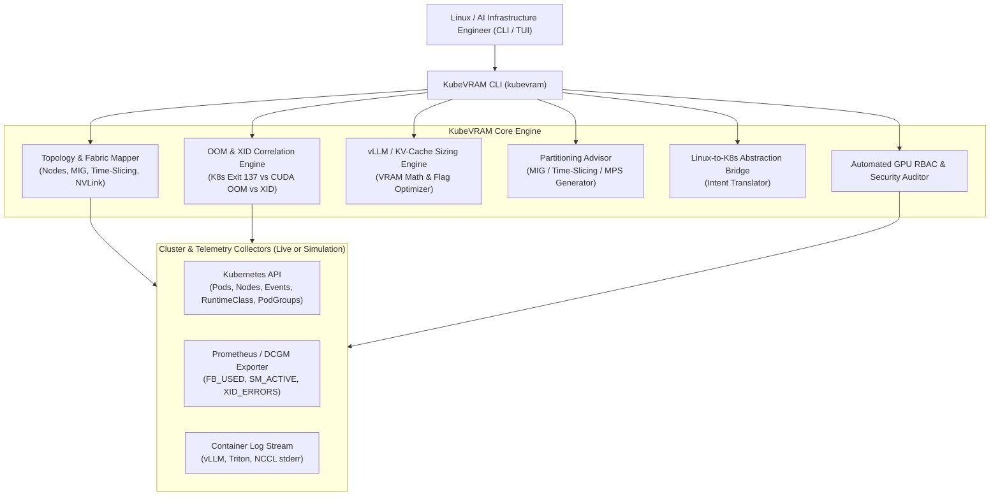

# KubeVRAM Architecture & Design Specification

## 1. Project Niche & Subject Matter Nomenclature

**KubeVRAM** is an AI-augmented, terminal-centric Kubernetes Day-2 operations and observability CLI purpose-built for **GPU Cluster & LLM Inference Engineering**.

It acts as:
1. **An Advanced Cluster GPU Topology & Fabric Mapper**: Visualizing physical GPUs, MIG instances, Time-Slicing over-subscription, NVLink/PCIe fabrics, and active VRAM saturation (`DCGM_FI_DEV_FB_USED`) directly in the terminal.
2. **An Automated Triage & OOM Correlation Assistant**: Correlating Kubernetes Pod states (`OOMKilled` Exit 137 vs `Error` Exit 1 vs `SIGBUS` Exit 135), DCGM hardware telemetry (`DCGM_FI_DEV_FB_USED`, `DCGM_FI_DEV_XID_ERRORS`), and inference engine logs (`vLLM`, `Triton`, `KServe`) to deliver deterministic Root Cause Analysis (RCA).
3. **A Kubernetes-to-Linux Abstraction Bridge**: Translating traditional Linux system and GPU administration intents (`nvidia-smi`, `nvidia-smi topo -m`, `dmesg -T`, `htop`, `numactl`, `ipcs -m`, `ulimit`) into Kubernetes API queries, PromQL/DCGM lookups, and declarative YAML patches.
4. **A Declarative State & Inference Runtime Tuner**: Calculating exact vLLM KV-cache memory budgets (`--gpu-memory-utilization`, `--max-model-len`, Tensor Parallelism) and generating ready-to-apply MIG / Time-Slicing / MPS configurations.

### Market Gap

| Existing Tool | Focus Area | Critical Blind Spot for AI Inference Engineers |
| :--- | :--- | :--- |
| **`k9s`** | General K8s CRUD TUI | Displays CPU/System RAM via `metrics-server`; blind to GPU VRAM, MIG slices, NVLink topology, and XID faults. |
| **`k8sgpt`** | Generic K8s event analyzer | Treats `CrashLoopBackOff` generically; does not correlate DCGM framebuffer metrics with vLLM KV-cache pre-allocation or Time-Slicing collisions. |
| **`Popeye`** | Static YAML linter | Audits generic best practices; lacks domain models for `/dev/shm` NCCL sizing, `RuntimeClass: nvidia`, MIG profiles, or Gang Scheduling deadlocks. |
| **`KubeVRAM`** | **GPU & AI Inference Day-2 CLI** | Bridges Linux/CUDA mental models directly to Kubernetes + DCGM + vLLM/KServe with actionable YAML remediation. |

---

## 2. Core System Architecture

---

## 3. Core Functional Pillars

### 3.1 Context-Aware Root Cause Analysis (`kubevram triage`)
Correlates four telemetry streams simultaneously:
- **Pod Status & Exit Codes**: `lastState.terminated.exitCode` (`137` vs `1` vs `135`) and `reason` (`OOMKilled` vs `Error`).
- **DCGM Hardware Telemetry**: Framebuffer utilization (`DCGM_FI_DEV_FB_USED`), temperature/power throttling, and `DCGM_FI_DEV_XID_ERRORS`.
- **Node Sharing Strategy**: Inspects `nvidia.com/gpu.sharing-strategy` (`time-slicing`, `mig`, `mps`, or `none`).
- **Container Log Signatures**: Detects vLLM KV-cache initialization errors, PyTorch `cudaErrorMemoryAllocation`, NCCL `/dev/shm` bus errors, and ECC hardware faults.

### 3.2 Declarative State Translation (`kubevram bridge` & `kubevram partition`)
- Translates Linux/CUDA admin commands (`nvidia-smi`, `nvidia-smi topo -m`, `dmesg -T | grep -i xid`, `free -h`, `ipcs -m`) into exact `kubectl`, PromQL, and declarative Kubernetes patches.
- Generates production-ready ConfigMaps for **MIG (`mig-parted`)**, **Time-Slicing**, and **CUDA MPS** based on hardware SKU and workload tenancy.

### 3.3 Dynamic Resource Tuning (`kubevram tune-vllm`)
- Computes exact weight memory, CUDA context/graph overhead, and per-token KV cache footprint ($2 \times L \times n_{\text{kv\_heads}} \times d_{\text{head}} \times \text{dtype}$).
- Recommends deterministic `--gpu-memory-utilization`, `--max-model-len`, `--tensor-parallel-size`, and `--kv-cache-dtype` flags and outputs a ready-to-apply Kubernetes `Deployment` manifest.

### 3.4 Automated RBAC & Runtime Security Auditing (`kubevram rbac-audit`)
- Audits GPU workload security posture across namespaces.
- Detects over-privileged inference pods (`privileged: true` where `runtimeClassName: nvidia` suffices), wildcard secret access, `/dev/shm` misconfigurations on multi-GPU workloads, and missing `PodGroup` Gang Scheduling configurations.
