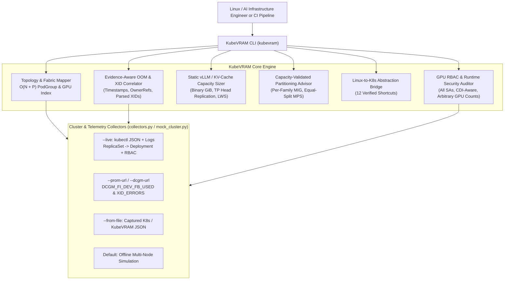

# KubeVRAM Architecture & Design Specification

## 1. Project Niche & Subject Matter Nomenclature

**KubeVRAM** is a terminal-centric Kubernetes Day-2 operations and observability CLI purpose-built for **GPU Cluster & LLM Inference Engineering**.

It acts as:
1. **A Cluster GPU Topology & Fabric Mapper**: Visualizing physical GPUs, MIG instances, Time-Slicing over-subscription, NVLink/PCIe fabrics, and active VRAM saturation (`DCGM_FI_DEV_FB_USED`) directly in the terminal or JSON pipelines.
2. **An Evidence-Aware Triage & OOM Correlation Engine**: Correlating Kubernetes Pod and per-container states (`OOMKilled` Exit 137 vs `Error` Exit 1 vs `SIGBUS` Exit 135), termination vs. scrape timestamps, DCGM hardware telemetry (`DCGM_FI_DEV_FB_USED`, `DCGM_FI_DEV_XID_ERRORS`), owner references (`Deployment`/`StatefulSet`/`Job`), and inference engine logs (`vLLM`, `Triton`, `KServe`).
3. **A Kubernetes-to-Linux Abstraction Bridge**: Translating traditional Linux system and GPU administration intents (`nvidia-smi`, `nvidia-smi topo -m`, `dmesg -T`, `htop`, `numactl`, `ipcs -m`, `ulimit`) into Kubernetes API queries, PromQL/DCGM lookups, and verified `kubevram` shortcuts.
4. **A Static VRAM Capacity & Partitioning Sizer**: Calculating static vLLM weight + KV-cache memory budgets (including GQA KV-head replication under Tensor Parallelism), validating flags against `vllm/vllm-openai:v0.6.4`, emitting single-node `Deployment` or multinode `LeaderWorkerSet` manifests, and recommending capacity-validated MIG / MPS / Time-Slicing / Full-GPU configurations.

### Market Gap

| Existing Tool | Focus Area | Critical Blind Spot for AI Inference Engineers |
| :--- | :--- | :--- |
| **`k9s`** | General K8s CRUD TUI | Displays CPU/System RAM via `metrics-server`; blind to GPU VRAM, MIG slices, NVLink topology, and XID faults. |
| **`k8sgpt`** | Generic K8s event analyzer | Treats `CrashLoopBackOff` generically; does not correlate DCGM framebuffer metrics with vLLM KV-cache pre-allocation or Time-Slicing collisions. |
| **`Popeye`** | Static YAML linter | Audits generic best practices; lacks domain models for `/dev/shm` NCCL sizing, CDI/`RuntimeClass: nvidia`, MIG profiles, or Gang Scheduling deadlocks. |
| **`KubeVRAM`** | **GPU & AI Inference Day-2 CLI** | Bridges Linux/CUDA mental models directly to Kubernetes + DCGM + vLLM/KServe with evidence-calibrated RCA and validated YAML manifests. |

---

## 2. Core System Architecture

---

## 3. Core Functional Pillars & Engineering Invariants

### 3.1 Evidence-Aware Root Cause Analysis (`kubevram triage`)
Correlates multiple telemetry dimensions using an `O(1)` `ClusterLookupIndex`:
- **Active Hardware Faults First**: Checks `DCGM_FI_DEV_XID_ERRORS` on attached GPUs before filtering `Running` pods so uncontained ECC/bus faults (`XID 95`, `XID 79`) on live pods are never missed.
- **State Hygiene**: Skips clean completions (`Succeeded` / `Exit 0`), normal `Pending` scheduling queues, and healthy `Running` pods whose historical restarts occurred outside the recovery grace window (`> 300s`).
- **Explicit Crash Evidence**: High GPU VRAM allocation (`>= 90–95%`) is normal for pre-allocating engines like `vLLM` and never triggers `CUDA_VRAM_OOM` without explicit CUDA/KV-cache OOM log signatures. Similarly, `/dev/shm` `SIGBUS` requires `Exit 135` (`SIGBUS`) or explicit shared-memory failure logs.
- **Parsed XID Semantics**: Extracts the actual XID number from logs (`NVRM: Xid ...: 31`) and separates application/MMU faults (`XID 13`, `XID 31`, `XID 43`) from silicon/interconnect isolation faults (`XID 48`, `XID 63`, `XID 64`, `XID 74`, `XID 79`, `XID 92`, `XID 94`, `XID 95`).
- **Calibrated Confidence & Owner Targeting**: Caps confidence when termination/scrape timestamps are missing (`<= 0.84`) or stale (`> 300s` -> `<= 0.70`), records `evidence_gaps`, and targets real controller owners (`Deployment`, `StatefulSet`, `DaemonSet`, `Job`) and container names instead of guessing `deployment/{pod.name}`.

### 3.2 Static vLLM & KV-Cache Capacity Sizer (`kubevram tune-vllm`)
- **Exact Binary GiB Accounting**: Converts decimal parameter counts ($\times 10^9$) to binary $\text{GiB}$ ($\div 1024^3$) and raises `ValueError` on unrecognized or incompatible `dtype` / `kv_dtype` strings.
- **TP KV-Head Replication**: Models `vLLM`'s `max(1, ceil(num_kv_heads / tp))` assignment per worker:
  $$\text{KV}_{\text{bytes/token/GPU}} = 2 \times L \times \max\!\left(1, \left\lceil \frac{n_{\text{kv\_heads}}}{\text{TP}} \right\rceil\right) \times d_{\text{head}} \times b_{\text{kv}}$$
- **Unified Sizing & Manifest Contract**: Auto-selects the minimum fitting TP when `--num-gpus` is omitted so capacity figures, `--max-num-seqs`, and emitted manifests always describe the exact same GPU count. When an explicit `--num-gpus` is infeasible, `fits_in_vram` is `false` and no executable args/manifests are emitted.
- **Executable Manifests**: Emits flags valid on `vllm/vllm-openai:v0.6.4` (`--dtype=auto --quantization=fp8` for FP8), enforces GPU SKU and sharing-strategy `nodeAffinity`, and switches from `Deployment` (`TP <= 8`) to `LeaderWorkerSet` + Ray (`TP > 8`) for multinode serving.
- **Scope Boundary**: Evaluates **static VRAM feasibility and token capacity**; establishing latency/throughput optimality requires empirical benchmarking under target request arrival and sequence-length distributions.

### 3.3 Capacity-Validated Partitioning Advisor (`kubevram partition`)
- Rejects non-positive, `NaN`, or infinite VRAM inputs and flags single-GPU physical capacity overflow as `CRITICAL`.
- Uses SKU-family-accurate MIG profile tables (`A30`, `A100-40GB`, `A100/H100-80GB`, `H100-NVL`, `H200`, `B200`).
- Models NVIDIA `k8s-device-plugin` equal per-replica CUDA MPS memory division (`device_vram / replicas`), preventing infeasible multi-replica MPS recommendations when `2 × model_vram_gb` exceeds device memory.

### 3.4 GPU RBAC & Runtime Security Auditing (`kubevram rbac-audit`)
- Evaluates `wildcard_secrets` across **all** ServiceAccounts (including dedicated workload SAs).
- Respects node-level `default_runtime_is_nvidia` and `cdi_enabled` flags instead of blindly flagging omitted `runtimeClassName: nvidia`.
- Parses arbitrary integer GPU counts (`>= 2`, including 3, 5, etc.) while ignoring digits embedded in MIG profile names (`mig-2g.20gb`).
